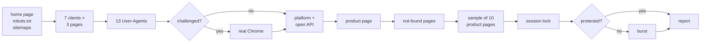

# recon

**Look a website over before you scrape it.**

[](https://github.com/ostashmarkian/recon/actions/workflows/tests.yml)


[](https://docs.astral.sh/ruff/)


recon is a command-line tool that probes a website the way a scraper developer
would by hand, and writes up what it found. It answers:

- what protects the site;
- which HTTP client gets in;
- how fast the site can be read;
- where its catalogue lives;
- whether its product data is clean enough to use.

One run takes about a minute and about 100 polite requests, plus up to 350 for the load test on sites
that nothing protects.

## Contents

- [Quick start](#quick-start)
- [What you get](#what-you-get)
- [Features](#features)
- [Usage](#usage)
- [How it works](#how-it-works)
- [Responsible use](#responsible-use)
- [Development](#development)
- [Roadmap](#roadmap)

## Quick start

```bash
pip install "site-recon @ git+https://github.com/ostashmarkian/recon"
recon https://www.example.com
```

The report is printed and saved to `./recon-reports/<host>-<date>.md`, with a
`.json` of the same findings next to it. To include the real-browser step,
install the `browser` extra and have Google Chrome on the machine:

```bash
pip install "site-recon[browser] @ git+https://github.com/ostashmarkian/recon"
```

Python 3.12+.

## What you get

The report opens with a verdict. This one is from a real shop behind
Cloudflare, abridged, with the shop's identity replaced:

> - **Protection: level 3 of 5, a filter by fingerprint.** Cloudflare turns away httpx HTTP/2, httpx HTTP/1.1, httpx HTTP/2 + PHA (challenge) with a browser User-Agent; let in: httpx HTTP/1.1 + PHA, curl_cffi as Chrome, curl_cffi as Safari, curl_cffi as Firefox. Python's own TLS is what is turned away: the TLS fingerprint decides. httpx with PHA passes over HTTP/1.1 only, so the HTTP/2 fingerprint counts too. A real browser is let in and gets cf_clearance, but the cookie does not carry over to the clients.
> - **Way in:** httpx HTTP/1.1 + PHA, a browser User-Agent, no cookies (a session lock)
> - **Session lock:** yes: 1.98/s with one cookie jar, 6.3/s with none, 4 at a time
> - **Burst:** skipped (for what is seen above)
> - **Product data:** JSON-LD mpn `PN-0001-A`, sku `1000000001`, brand `ACME COMPONENTS`, price `19.9800`, currency `USD`, availability `InStock`; no gtin; words for part number, maker, stock
> - **Product sample:** 10 of 10 pages read; mpn 10/10, sku 10/10, price 10/10; currency USD; a stock number on 0; no trap seen
> - **Not-found pages:** a made-up product redirects to /Errors/GenericError; a made-up path redirects to /Errors/GenericError
> - **Freshness:** cache DYNAMIC 11/11; Cache-Control `private`
> - **Sitemap:** 195,151 addresses in 8 files read, lastmod 2025-01-13 to 2026-01-13

Every line is backed by tables of the actual answers below it: which client
got which status on which page, what each User-Agent got, what Chrome saw, each
product page read, each not-found probe. See the full report:
[docs/example-report.md](docs/example-report.md).

## Features

**Protection and the way in**
- 7 HTTP clients: httpx over HTTP/1.1 and HTTP/2, each with Python's default TLS
  and with `post_handshake_auth`; curl_cffi impersonating Chrome, Safari and
  Firefox. Run on the home page, a product page and robots.txt.
- 13 User-Agents, from Chrome to `python-requests`, `Scrapy` and AI crawlers.
- Detects Cloudflare, Akamai, Imperva, DataDome, HUMAN, Sucuri, Kasada, F5,
  AWS WAF, Vercel, Myra and common CDNs from headers, cookies and challenge pages.
- When something is challenged, opens real Chrome (via patchright) and checks
  whether its `cf_clearance` cookie lets the other clients in.

**Pace**
- Session lock test: is the site slower with a cookie jar than without one?
  Some servers handle one session's requests one at a time.
- Burst test: 1, 2, 4, 8, 16 requests at a time, only on unprotected sites (see
  [Responsible use](#responsible-use)). Stops at the first sign of strain, a
  quiet one too: pages that still answer 200 but shrink to an error message.

**Platform and catalogue**
- Recognises 25 platforms, among them Shopify, WooCommerce, Magento,
  BigCommerce, PrestaShop, OpenCart and Next.js.
- Asks each platform's open API for its catalogue count: WooCommerce Store
  API, Shopify `products.json`, Magento and BigCommerce GraphQL, OpenCart's
  empty search.
- Reads sitemaps, plain or gzipped, and finds search services (Algolia,
  Searchanise, Klevu, Doofinder, Boost and others), `__NEXT_DATA__` blobs and
  the API paths the pages call.

**Data quality**
- Reads schema.org Product data (JSON-LD and microdata), product meta tags, and
  the page's own words for part number, maker, VAT and stock, in several
  languages.
- Samples 10 product pages and flags data traps:
  - an MPN that equals the SKU, or that is a GTIN, `4.84E+11` or `N/A`;
  - one MPN on several products;
  - the same stock on every page, or stock capped at `999+`;
  - price ladders, and VAT in or out of the price.
- Probes made-up pages to catch soft 404s, and listings that wrap back to
  page 1 past their end.
- Reads cache headers to tell when pages are served stale.

**Reports**
- A Markdown report and a JSON file per run.
- Each run is compared with the previous one of the same host, so a change
  (new protection, a client no longer let in, a field gone) stands out.

## Usage

```
recon URL [options]
python -m recon URL [options]
```

| Option | What it does |
|---|---|
| `--page URL` | the product page to read, instead of one picked from the sitemap |
| `--products N` | how many product pages to sample (default 10, `0` for none) |
| `--browser` | open Chrome even when no client was challenged |
| `--no-burst` | never run the burst test |
| `--pause S` | seconds between requests (default 0.5, or robots.txt's `Crawl-delay` if longer) |
| `--compare FILE` | compare with this earlier `.json` report (default: the newest one of the same host) |
| `--notes DIR` | look the site and its platform up in a folder of Markdown notes, such as an Obsidian vault (or `$RECON_NOTES`) |
| `--out DIR` | where reports go (default `./recon-reports`) |

As a library:

```python
import asyncio
from recon import Recon, report

findings = asyncio.run(Recon("https://www.example.com", burst=False).run())
print(findings["way_in"])
print(report(findings))
```

## How it works



The verdict opens with a protection level, from what the run saw:

| Level | Meaning |
|---|---|
| 0 | nothing in front, no client or User-Agent turned away |
| 1 | a service in front (a CDN, an anti-bot service), no client turned away; or a rate limit (a 429, or refusals with several requests at a time) |
| 2 | a filter by name: bot and tool User-Agents refused, any client with a browser User-Agent let in |
| 3 | a filter by fingerprint: some clients turned away even with a browser User-Agent (TLS, HTTP/2), others let in |
| 4 | a challenge for every client: only a real browser gets in |
| 5 | nothing let in, not even a browser |

It says who refused, what got through, and what one run cannot see, such as
limits over a long session.

Every answer is classified the same way. It is `ok`, `redirect`, `gone`,
`client-error`, `server-error`, a refusal (`challenge`, `blocked`, `refused`,
`limited`) with who refused it, or no answer (`dropped`, `error`).

The code is a package in `src/recon/`:

| Module | Responsibility |
|---|---|
| `probe` | `Recon`: runs the steps in order, the session test and the burst |
| `clients` | the HTTP clients behind one `Client` protocol; `fetch()` returns an `Answer`, never raises |
| `classify` | what one answer means, and which services stand in front |
| `pages` | sitemaps, product data, made-up addresses, listings, freshness |
| `platforms` | platform markers and their open APIs |
| `sample` | the product sample and its data traps |
| `findings` | what the findings add up to: protection, the way in, changes since last time |
| `report` | the Markdown report |
| `robots` | robots.txt as RFC 9309 reads it, the same on every Python version |
| `settings` | every tunable in one place |
| `browser`, `notes`, `cli` | Chrome via patchright, the notes folder, the command |

## Responsible use

recon is meant for sites you are allowed to scrape: your own, your clients',
or public sites whose terms permit it. It is careful by default:

- one request at a time, 0.5 s apart, or slower if robots.txt asks for a
  `Crawl-delay`; with a Crawl-delay, no concurrent test runs at all. A
  Crawl-delay over 60 s stops the run after robots.txt, unless you name a pace
  with `--pause`;
- robots.txt is read as RFC 9309 asks, redirects followed. If it cannot be read
  (a server error, a refusal, no answer), every page counts as disallowed.
  Sitemaps, platform APIs and the not-found probes are asked only where it
  allows, and so are the pages of the session test, the sample and the burst;
- links that look like they change the site's state are left out: a cart,
  checkout or account route (in several languages), `?add-to-cart=`,
  `?remove_item=`, `action=add`. It is a list of patterns, so a shop with its
  own words for these can slip past it;
- a home page that redirects to another site stops the run: recon looks at the
  site it is given, and names the address to run it on;
- any refusal, in any step, keeps the burst off;
- **the burst runs only when nothing protects the site.** Any anti-bot service
  in front, a browser-like client turned away, or a Crawl-delay turns it off.
  It stops at the first refusal, dropped connection or slowdown, and at
  pages that answer 200 but shrink: under half the smallest page read one at a
  time, and twice as big when read alone (a server failing quietly, as a
  644-byte database error in place of a product page). Then it waits 30 s
  before one last check that the site has let go;
- no captcha solving, no logins.

The client matrix tells you what a site lets through. It is not a way past a
site that says no.

**Limitations.**
- A sample of ten pages shows the shape of the data, not the whole catalogue.
- Heuristics can pick a page that is not a product; pass `--page` if so.
- The burst finds a lower bound, not the real limit.
- Pages drawn by JavaScript are flagged, but their data is not read.

## Development

```bash
git clone https://github.com/ostashmarkian/recon && cd recon
python -m venv .venv && .venv/bin/pip install -e ".[dev,browser]"   # .venv\Scripts\ on Windows
pytest                                       # 166 tests, offline, ~75 s
ruff check src tests && ruff format --check src tests
mypy
```

The tests never touch the network. `tests/fakes.py` holds `FakeSite`, a
stand-in shop with a sitemap, product pages and a listing. It can play many
sites: Cloudflare challenging httpx, User-Agent filters, a session lock, a
rate limit, dropped connections, a slowing server, soft 404s, a wrapping
listing, a Crawl-delay, Myra in front, or 200s that shrink under load.

The real `Recon` runs against it. Each safety rule was checked by breaking the
code on purpose and watching a test fail. CI runs ruff, mypy and the tests on
Linux and Windows for Python 3.12–3.14.

Contributions are welcome. [CONTRIBUTING.md](CONTRIBUTING.md) shows where to
add a platform, an anti-bot service or a language.

## Roadmap

- `recon scaffold`: generate a starter scraper from the findings (client,
  headers, pace, catalogue source)
- `recon batch sites.txt`: many sites, one summary table, an HTML report
- signatures of platforms, anti-bot services and search services as data
  files, so they can be added without touching code
- `--render`: read the data of pages drawn by JavaScript through the browser
- listing checks: page-size limits, stable sorting, catalogue size from
  several sources
- `--proxy`, and a HAR export of every request
- a release on PyPI

## License

[MIT](LICENSE)
