# recon

**Look a website over before you scrape it.**

[](https://github.com/ostashmarkian/recon/actions/workflows/tests.yml)


[](https://docs.astral.sh/ruff/)


recon is a command-line tool that probes a website the way a scraper developer
would by hand, and writes up what it found. It answers:

- what protects the site;
- which HTTP client gets in;
- how fast the site can be read;
- where its catalogue lives, its own API among it;
- whether its product data is clean enough to use.

One run takes a minute or two and about 100 polite requests, up to 30 more for the site's JS files and a few
for its API, and three pages in Chrome where it is installed; plus up to 350 for the load test on sites that
nothing protects.

## Contents

- [Quick start](#quick-start)
- [What you get](#what-you-get)
- [Features](#features)
- [Usage](#usage)
- [How it works](#how-it-works)
- [Responsible use](#responsible-use)
- [Development](#development)
- [Roadmap](#roadmap)

## Quick start

```bash
pip install "site-recon @ git+https://github.com/ostashmarkian/recon"
recon https://www.example.com
```

The report is printed and saved to `./recon-reports/<host>-<date>.md`, with a
`.json` of the same findings next to it. To include the real-browser step,
install the `browser` extra and have Google Chrome on the machine:

```bash
pip install "site-recon[browser] @ git+https://github.com/ostashmarkian/recon"
```

Python 3.12+.

## What you get

The report opens with a verdict. This one is from a real shop behind
Cloudflare, abridged, with the shop's identity replaced:

> - **Protection: level 3 of 5, a filter by fingerprint.** Cloudflare turns away httpx HTTP/2, httpx HTTP/1.1, httpx HTTP/2 + PHA (challenge) with a browser User-Agent; let in: httpx HTTP/1.1 + PHA, curl_cffi as Chrome, curl_cffi as Safari, curl_cffi as Firefox. Python's own TLS is what is turned away: the TLS fingerprint decides. httpx with PHA passes over HTTP/1.1 only, so the HTTP/2 fingerprint counts too. A real browser is let in and gets cf_clearance, but the cookie does not carry over to the clients.
> - **Way in:** httpx HTTP/1.1 + PHA, a browser User-Agent, no cookies (a session lock)
> - **Session lock:** yes: 1.98/s with one cookie jar, 6.3/s with none, 4 at a time
> - **Burst:** skipped (for what is seen above)
> - **Product data:** JSON-LD mpn `PN-0001-A`, sku `1000000001`, brand `ACME COMPONENTS`, price `19.9800`, currency `USD`, availability `InStock`; no gtin; words for part number, maker, stock
> - **Product sample:** 10 of 10 pages read; mpn 10/10, sku 10/10, price 10/10; currency USD; a stock number on 0; no trap seen
> - **Not-found pages:** a made-up product redirects to /Errors/GenericError; a made-up path redirects to /Errors/GenericError
> - **Freshness:** cache DYNAMIC 11/11; Cache-Control `private`
> - **Sitemap:** 195,151 addresses in 8 files read, lastmod 2025-01-13 to 2026-01-13

Every line is backed by tables of the actual answers below it: which client
got which status on which page, what each User-Agent got, what Chrome saw, each
product page read, each not-found probe. See the full report:
[docs/example-report.md](docs/example-report.md).

## Features

**Protection and the way in**
- 7 HTTP clients: httpx over HTTP/1.1 and HTTP/2, each with Python's default TLS
  and with `post_handshake_auth`; curl_cffi impersonating Chrome, Safari and
  Firefox. Run on the home page, a product page and robots.txt.
- 13 User-Agents, from Chrome to `python-requests`, `Scrapy` and AI crawlers.
- Detects Cloudflare, Akamai, Imperva, DataDome, HUMAN, Sucuri, Kasada, F5,
  AWS WAF, Vercel, Myra, Alibaba Cloud and common CDNs from headers, cookies,
  challenge pages and a host's CNAME.
- When something is challenged, opens real Chrome (via patchright) and checks
  whether its `cf_clearance` cookie lets the other clients in.

**Pace**
- Session lock test: is the site slower with a cookie jar than without one?
  Some servers handle one session's requests one at a time.
- Burst test: 1, 2, 4, 8, 16 requests at a time, only on unprotected sites (see
  [Responsible use](#responsible-use)). Stops at the first sign of strain, a
  quiet one too: pages that still answer 200 but shrink to an error message.

**Platform and catalogue**
- Recognises 25 platforms, among them Shopify, WooCommerce, Magento,
  BigCommerce, PrestaShop, OpenCart and Next.js.
- Asks each platform's open API for its catalogue count: WooCommerce Store
  API, Shopify `products.json`, Magento and BigCommerce GraphQL, OpenCart's
  empty search.
- Reads sitemaps, plain or gzipped, guessed where robots.txt names none,
  redirects on the site followed and named, and finds search services
  (Algolia, Searchanise, Klevu, Doofinder, Boost and others), `__NEXT_DATA__`
  blobs and the API paths the pages call.

**The site's own API, on every run**
- Without a browser: the API bases the pages' runtime config names (Nuxt's
  `window.__NUXT__.config`, Next.js's `__NEXT_DATA__`, an `apiHost` or
  `API_URL` in a script). Each host is looked up in DNS: one with no public DNS
  is the servers' own, named and never asked; a public one is asked once, for
  its robots.txt, and the report says what stands in front of it, which can be
  another service than the site's.
- The routes the pages' own JS bundles name, with their methods, grouped as
  lists and search, detail, stock and price; and a helper that adds
  parameters to the calls (`addAntiSpiderParams`), with what it sets. Its own
  bundles only: on the site's host, another host of its domain, or the CDN
  its runtime config names (Nuxt's `cdnURL`, Next's `assetPrefix`).
- What the pages' state holds (Nuxt 3's `__NUXT_DATA__`, Next.js's
  `__NEXT_DATA__`): each product list's key path, its size and the counts
  beside it, and the product a product page is about. A listing drawn on the
  server shows its products here and in no XHR. The listing read is one found
  to list products: one met on the way, else the product page's own category.
- List or search routes found are asked with the plain client the site lets
  in, no cookie or token: on the site's own API base first (one on its
  domain, then one an `apiHost`, `API_URL` or `baseURL` key names), then the
  other bases until one answers other than 404. Does it give JSON, whatever
  its Content-Type? An answer that says what it lacks (`Either cate_id or
  keyword is required`) is said to be an error message, and asked once more
  with a value the run has: the product page's part number as its search
  word, else a listing's category id.
- Where patchright and Chrome are installed (`--no-watch` skips it), opens the
  home page, the product page and a listing in Chrome and lists the XHR and
  fetch calls they make. Each answer is read for a scraper: a product list
  (where it sits, how many items, which of ids, names, prices and stock they
  carry), its paging keys, an HTML fragment of product links, a GraphQL
  operation. It sees what a page asks for as it opens and scrolls: a call made
  only on a click, such as a next-page button, does not show.
- Each product list the site's own API answered is then asked once more with
  the plain client the site lets in, with no cookie and no token. The report
  says whether the API works without the browser, and if not, what the page
  sent beyond a browser's usual headers: `authorization`, `x-csrf-token`, its
  cookies. It gives their names, never their values.

**Data quality**
- Reads schema.org Product data (JSON-LD and microdata), product meta tags, the
  product in the page's state (a part number in `mpn`, `partNumber`, `pro_sno`),
  and the page's own words for part number, maker, VAT and stock, in several
  languages.
- Tells a listing from a product page (an ItemList of Products, several
  Products side by side, a product list in its state, a page number) and keeps
  listings out of the product page and the sample.
- Samples 10 product pages and flags data traps:
  - an MPN that equals the SKU, or that is a GTIN, `4.84E+11` or `N/A`;
  - one MPN on several products;
  - the same stock on every page, or stock capped at `999+`;
  - price ladders, and VAT in or out of the price.
- Probes made-up pages to catch soft 404s, and listings that wrap back to
  page 1 past their end.
- Reads cache headers to tell when pages are served stale.

**Reports**
- A Markdown report and a JSON file per run.
- Each run is compared with the previous one of the same host, so a change
  (new protection, a client no longer let in, a field gone) stands out.

## Usage

```
recon URL [options]
python -m recon URL [options]
```

| Option | What it does |
|---|---|
| `--page URL` | the product page to read, instead of one picked from the sitemap |
| `--products N` | how many product pages to sample (default 10, `0` for none) |
| `--browser` | open Chrome even when no client was challenged |
| `--no-burst` | never run the burst test |
| `--no-watch` | do not open three pages in Chrome to list the JSON and HTML fragments they fetch (done by default where patchright and Chrome are installed; `--watch` is still accepted and does nothing) |
| `--long [MIN]` | also one slow session over MIN minutes (default 15), a request every 5-10 s: does a bot manager turn it away later? |
| `--pause S` | seconds between requests (default 0.5, or robots.txt's `Crawl-delay` if longer) |
| `--compare FILE` | compare with this earlier `.json` report (default: the newest one of the same host) |
| `--notes DIR` | look the site and its platform up in a folder of Markdown notes, such as an Obsidian vault (or `$RECON_NOTES`) |
| `--out DIR` | where reports go (default `./recon-reports`) |

As a library:

```python
import asyncio
from recon import Recon, report

findings = asyncio.run(Recon("https://www.example.com", burst=False).run())
print(findings["way_in"])
print(report(findings))
```

## How it works

```mermaid
flowchart LR
    A[home page<br/>robots.txt<br/>sitemaps] --> B[7 clients ×<br/>3 pages]
    B --> C[13 User-Agents]
    C --> D{challenged?}
    D -- yes --> E[real Chrome]
    D -- no --> F[platform +<br/>open API]
    E --> F
    F --> G[product page]
    G --> H[not-found pages]
    H --> S[sample of 10<br/>product pages]
    S --> P[its own API:<br/>config, DNS,<br/>bundles, state]
    P --> W[3 pages<br/>in Chrome]
    W --> I[session lock]
    I --> J{protected?}
    J -- no --> K[burst]
    J -- yes --> L[report]
    K --> L
```



The verdict opens with a protection level, from what the run saw:

| Level | Meaning |
|---|---|
| 0 | nothing in front, no client or User-Agent turned away |
| 1 | a service in front (a CDN, an anti-bot service), no client turned away; or a rate limit (a 429, or refusals with several requests at a time) |
| 2 | a filter by name: bot and tool User-Agents refused, any client with a browser User-Agent let in |
| 3 | a filter by fingerprint: some clients turned away even with a browser User-Agent (TLS, HTTP/2), others let in |
| 4 | a bot manager in front: every client let in now, but it scores each one over its session, so a long run can be turned away |
| 5 | a challenge for every client: only a real browser gets in (whether its cookie then carries over to the clients is in **Way in**) |
| closed | not on the scale: not even a browser got in, or the refusals were no challenge a browser could pass |
| not judged | no client got an answer in time |

It says who refused, what got through, and what one run cannot see, such as
limits over a long session.

Level 4 is about what stands in front, because a short run can be let in
where a long one is not. A bot manager is recognised by its own product's
markers, not by the vendor's name alone: Akamai with its Bot Manager cookies,
Cloudflare with `__cf_bm` (set by its Bot Management and Bot Fight Mode),
DataDome, HUMAN, Kasada, Myra. A WAF that acts on its owner's rules stays at
what the run saw, and the verdict says that this holds until the rules change.
`--long` shows whether a bot manager acts: one cookie jar walks the site for 15
minutes, a request every 5-10 s, and the report says at which request and
minute it was turned away, if it was. A long session turned away is level 4 as
well; a 429 there is a rate limit. An answer lost there is checked against two
neutral hosts first: when they are silent too, this machine's link failed, not
the site, and the session waits for it and goes on.

An API host is judged on its own: its server, cookies and CNAME are named in
the API line, and what stands in front of it does not change the site's level.
Alibaba Cloud's WAF (its `acw_tc` and `cdn_sec_tc` cookies, the `acw_sc__v2`
challenge) counts as a guard, since it bans an IP by its rate; its CDN alone
(`Server: Tengine` with `EagleId` or `Via: ens-cache`) does not.

Every answer is classified the same way. It is `ok`, `redirect`, `gone`,
`client-error`, `server-error`, a refusal (`challenge`, `blocked`, `refused`,
`limited`) with who refused it, or no answer (`dropped`, `error`).

The code is a package in `src/recon/`:

| Module | Responsibility |
|---|---|
| `probe` | `Recon`: runs the steps in order, the session test and the burst |
| `clients` | the HTTP clients behind one `Client` protocol; `fetch()` returns an `Answer`, never raises |
| `classify` | what one answer means, and which services stand in front |
| `pages` | sitemaps, product data, a listing told from a product page, made-up addresses, freshness |
| `platforms` | platform markers and their open APIs |
| `sample` | the product sample and its data traps |
| `findings` | what the findings add up to: protection, the way in, changes since last time |
| `report` | the Markdown report |
| `robots` | robots.txt as RFC 9309 reads it, the same on every Python version |
| `settings` | every tunable in one place |
| `calls` | what the pages' own XHR and fetch calls answer: product lists, paging, fragments, JSON by its body |
| `api` | the site's own API without a browser: API bases in runtime configs, their hosts, routes in JS bundles |
| `state` | a page's state (Nuxt's `__NUXT_DATA__`, Next.js's `__NEXT_DATA__`): its product lists and its product |
| `browser`, `notes`, `cli` | Chrome via patchright, the notes folder, the command |

## Responsible use

recon is meant for sites you are allowed to scrape: your own, your clients',
or public sites whose terms permit it. It is careful by default:

- one request at a time, 0.5 s apart, or slower if robots.txt asks for a
  `Crawl-delay`; with a Crawl-delay, no concurrent test runs at all. A
  Crawl-delay over 60 s stops the run after robots.txt, unless you name a pace
  with `--pause`;
- robots.txt is read as RFC 9309 asks, redirects followed. If it cannot be read
  (a server error, a refusal, no answer), every page counts as disallowed.
  Sitemaps, platform APIs and the not-found probes are asked only where it
  allows, and so are the pages of the session test, the sample and the burst;
- links that look like they change the site's state are left out: a cart,
  checkout or account route (in several languages), `?add-to-cart=`,
  `?remove_item=`, `action=add`. It is a list of patterns, so a shop with its
  own words for these can slip past it;
- a home page that redirects to another site stops the run: recon looks at the
  site it is given, and names the address to run it on;
- any refusal of the site's own pages, in any step, keeps the burst off. An
  API route's 401 (a key it wants) and a refusal by an API host or a CDN are
  theirs: reported with the API, they say nothing of the site's own guard;
- the site's JS files are read one at a time like every page, 30 at most, only
  its own (on its host, another host of its domain, or the CDN its runtime
  config names, whose robots.txt is asked first) and only where robots.txt
  allows. An API host is asked for its robots.txt once, and then only what
  that allows: list or search routes, by GET, four requests at most, no
  cookie or token. A host with no public DNS or a private address is never
  asked anything, not even its robots.txt;
- the API step never asks a POST route or a route that may change the site's
  state. The watch's replay sends a page's own POST once more (a search query,
  say), but never a GraphQL mutation or a route that may change the site's
  state;
- the watch opens three pages robots.txt allows in Chrome, as a visitor would,
  and only where a plain client was let in: it reads what a site shows, it is
  no way past a site that says no;
- `--long` asks one page every 5-10 s (or the Crawl-delay), slower than the
  rest of the run, so it runs behind protection too; it stops at the first
  refusal. At an answer lost it asks a neutral host
  (`https://www.cloudflare.com/cdn-cgi/trace`, then Google's `generate_204`),
  and while those are silent too it waits 30 s at a time;
- **the burst runs only when nothing protects the site.** Any anti-bot service
  in front, a browser-like client turned away, or a Crawl-delay turns it off.
  It stops at the first refusal, dropped connection or slowdown, and at
  pages that answer 200 but shrink: under half the smallest page read one at a
  time, and twice as big when read alone (a server failing quietly, as a
  644-byte database error in place of a product page). Then it waits 30 s
  before one last check that the site has let go;
- no captcha solving, no logins.

The client matrix tells you what a site lets through. It is not a way past a
site that says no.

**Limitations.**
- A sample of ten pages shows the shape of the data, not the whole catalogue.
- Heuristics can pick a page that is not a product; pass `--page` if so.
- The burst finds a lower bound, not the real limit.
- Pages drawn by JavaScript are flagged; their data is read only where it sits
  in a state recon knows (Nuxt 3, Next.js, `window.__INITIAL_STATE__`).
- API routes are read from the bundles' text: a route built from parts at run
  time, or one loaded only after a click, does not show.

## Development

```bash
git clone https://github.com/ostashmarkian/recon && cd recon
python -m venv .venv && .venv/bin/pip install -e ".[dev,browser]"   # .venv\Scripts\ on Windows
pytest                                       # 275 tests, offline, ~160 s
ruff check src tests && ruff format --check src tests
mypy
```

The tests never touch the network. `tests/fakes.py` holds `FakeSite`, a
stand-in shop with a sitemap, product pages and a listing. It can play many
sites: Cloudflare challenging httpx, User-Agent filters, a session lock, a
rate limit, dropped connections, a slowing server, soft 404s, a wrapping
listing, a Crawl-delay, Myra in front, 200s that shrink under load, a
block that comes only late in a long session, a local link that goes down,
or a sitemap behind a redirect. `NuxtSite` plays a Nuxt 3 shop whose
categories outnumber its products, its API on another host behind Alibaba
Cloud asking for a search word, an internal API host in its runtime config,
routes in its JS bundles and products in its `__NUXT_DATA__`.

The real `Recon` runs against it. Each safety rule was checked by breaking the
code on purpose and watching a test fail. CI runs ruff, mypy and the tests on
Linux and Windows for Python 3.12–3.14.

Contributions are welcome. [CONTRIBUTING.md](CONTRIBUTING.md) shows where to
add a platform, an anti-bot service or a language.

## Roadmap

- `recon scaffold`: generate a starter scraper from the findings (client,
  headers, pace, catalogue source)
- `recon batch sites.txt`: many sites, one summary table, an HTML report
- signatures of platforms, anti-bot services and search services as data
  files, so they can be added without touching code
- `--render`: read the data of pages drawn by JavaScript through the browser
- the watch deeper: follow a product list's paging call once, to show which
  parameter pages and how far
- listing checks: page-size limits, stable sorting, catalogue size from
  several sources
- `--proxy`, and a HAR export of every request
- a release on PyPI

## License

[MIT](LICENSE)
